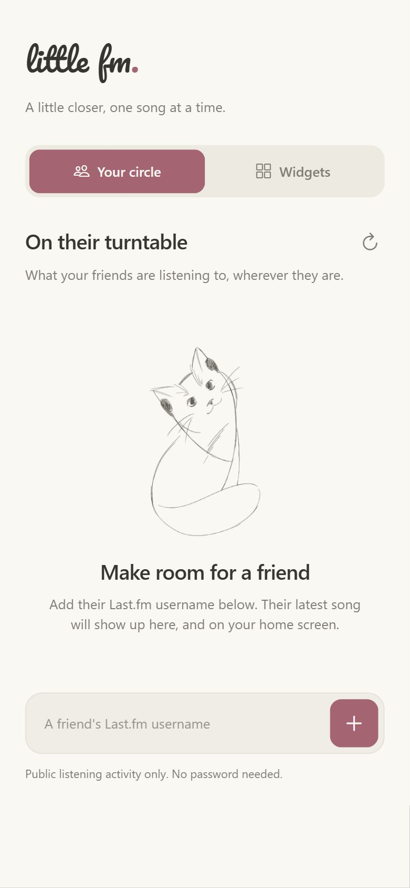
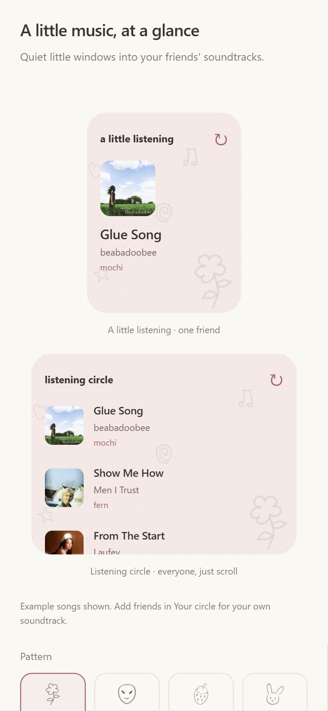

  

<h1 align="center">little fm</h1>

A little closer, one song at a time.

<a href="https://github.com/Nyaughh/little-fm/releases/latest">Download for Android</a>

Your friends' latest Last.fm songs, in a little corner of your home screen.

- Add friends with their Last.fm usernames.
- Feature one friend, or scroll through your whole circle.
- Pick your colors and hand-drawn patterns.

### Make room for a friend

Download the APK from [Releases](https://github.com/Nyaughh/little-fm/releases/latest), install little fm, and add a friend.

For a home screen widget, long-press an empty spot, tap **Widgets**, and find **little fm**.

Once placed, long-press your widget and drag its edges to make it fit.

Android only. No Last.fm password needed.

### App preview

  
  

